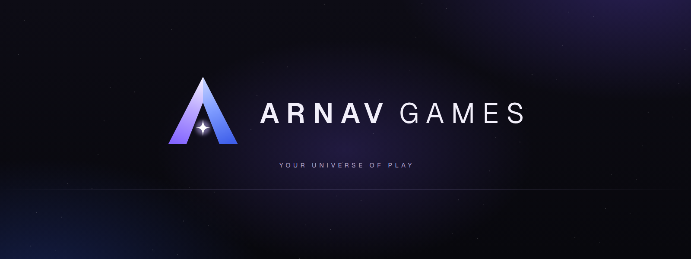

<p align="center">
  
</p>

<p align="center"><strong>Your Universe of Play.</strong><br/>One beautiful, private home for every PC game you own — Steam, Xbox &amp; PC Game Pass, Epic, GOG, EA, Ubisoft and Battle.net.</p>

<p align="center">
  <a href="https://github.com/Arnav-Dugad/arnav-games/releases/latest/download/Vystral-win-Setup.exe"><strong>⬇ Download Arnav Games for Windows</strong></a>
  &nbsp;·&nbsp;
  <a href="https://github.com/Arnav-Dugad/arnav-games/releases/latest">All downloads &amp; release notes</a>
</p>

<p align="center"><sub>Arnav Games was called VYSTRAL before 1.0.0. Existing installs update in place and keep their library, settings and keys.</sub></p>

---

## Install

1. Click **[Download Arnav Games for Windows](https://github.com/Arnav-Dugad/arnav-games/releases/latest/download/Vystral-win-Setup.exe)** — that link always points to the newest version.
2. Run `Vystral-win-Setup.exe` (the installer keeps the app’s original file name). It installs just for you (no administrator rights) and adds Desktop and Start-menu shortcuts.
3. **Windows SmartScreen may warn** that the app is from an unknown publisher, because Arnav Games isn’t code-signed yet (signing certificates cost money). Click **More info → Run anyway**. The installer only comes from this repository’s Releases page — never download it anywhere else.
4. Arnav Games finds your installed games automatically. Nothing to sign in to.

**Updates are automatic.** Arnav Games checks GitHub shortly after it starts, shows the download with a live progress viewer (Settings → Updates, or the pill in the title bar), and installs when you restart. You can turn this off.

**Requirements:** Windows 10 21H2+ or Windows 11, x64. The WebView2 runtime (built into Windows 11) is installed automatically if missing. Uninstall from *Settings → Apps*; your library data in `%LOCALAPPDATA%\VYSTRAL.Data` is kept unless you delete that folder.

> Prefer a portable copy? Download `Vystral-win-Portable.zip` from the release page. The portable copy doesn’t auto-update.

## What it does

| | |
|---|---|
| **Every store, one library** | Reads Steam, Xbox/Game Pass, Epic, GOG, EA app, Ubisoft Connect and Battle.net installs directly from what those apps keep on your PC — no passwords, no sign-in. Add any other game or program yourself. |
| **Launches the right way** | Each game starts through its store’s official mechanism (or directly for DRM-free GOG/manual games). Arnav Games confirms the game actually started before it says so, and never relaunches anything on its own. |
| **Smart duplicates** | Own a game on two stores? It appears once, with a chooser for which store to play from. Different editions and remasters are never merged automatically — you decide. |
| **Living Canvas** | A calm animated background with depth that takes on each game’s colours and mood (light trails for racing, stars for space, fog for horror…) and the time of day. It pauses whenever you’re playing. Take the whole app’s accent from a favourite game’s cover, and choose which page opens first. |
| **Live Home** | Steam games’ tiles come alive with their short, silent store loops while on screen (two at a time, never on Data saver); an *Owned, never played* gallery with gentle picks for tonight; optional ambient sound that follows each game’s mood. |
| **Command bar** (`Ctrl+K`) | “installed racing games under 20 GB”, “launch forza”, “not played in 3 months”, “everything on my second SSD” — understood instantly, on your PC, without AI. |
| **Discover** | A storefront of picks, "Because you played" rows and Steam shelves; search any game, owned or not, across Steam, Wikidata and (with your keys) IGDB and RAWG, with pages for games you don't own: trailer, prices, time to beat and where to get it. |
| **Immersive Mode** (`F11`) | A console-grade full-screen layout with a cinematic way in, trailer backdrops, a guide on the Menu button, a radial quick menu, Now playing and Downloads rows, letter jumps, a game page with tabs, a live system bar, couch text sizes, spatial sounds and optional voice-over with captions. |
| **Performance Mode** | When a game starts, Arnav Games minimizes and suspends its interface: **0% CPU** while minimized in our measurements. |
| **Journal & Performance** | Private play history, when-you-play heatmaps, genre drift, completion forecasts, hardware history, an optional energy estimate, playtime charts, milestones, game status (Backlog → Completed) and per-session CPU/GPU/temperature graphs. Optional real FPS, 1% lows and stutters via Intel PresentMon. Nothing is estimated or faked. |
| **Launches that explain themselves** | A pre-flight card (disk space, pending updates, controller battery, HDR), a progress arc that learns how long each game takes, one-click fixes when something fails, and GPU heat alerts afterwards. |
| **Storage Studio** | A map of each drive showing which games take the space, with gentle suggestions. Arnav Games never deletes: uninstalling happens in the store. |
| **Library health** | One page finds games that can't start, unplugged drives, duplicates, blurry art and sessions that never ended, with safe fixes. Steam updates that won't fit are flagged before they start. |
| **Cloud play (optional)** | GeForce NOW and Xbox Cloud Gaming for games you own, from the services' public game lists, opened in their official app or site, with an hours-left meter. |
| **Your subscriptions** | Tell Arnav Games which plans you have (Game Pass, EA Play, Ubisoft+, GeForce NOW…) and it shows what they include, what's leaving soon and what they're worth to you. |
| **Play calendar & achievements** | A year of play day by day with streaks, every Steam achievement on one timeline (rare ones highlighted), achievement toasts after a session, and frame rates before vs after a driver update. |
| **Controller-first** | Crisp button icons for Xbox, PlayStation and Nintendo pads, gentle haptics, a docked on-screen keyboard for every text box, and hold-to-confirm for anything you can't undo. |
| **Steam extras** | Live install progress and trailers, each game's Steam Input layout on a Controls tab, friends playing now (opt-in); with your own Steam Web API key (kept in Windows Credential Manager), games you own but haven’t installed and achievements with rarity. |
| **Tracks games you start anywhere** | Launch from Steam or a shortcut and the session is still recorded, even while Arnav Games is closed (optional tiny helper). |
| **Art, details and deals** | SteamGridDB art picker, IGDB/RAWG details, CheapShark/IsThereAnyDeal prices, Steam Deck and anti-cheat badges, cross-store IDs from Wikidata. Keys are your own. |
| **Windows integration** | A summon shortcut (`Ctrl+Alt+V`), Windows notifications, a notification centre and a now-playing chip. |
| **Moments** | Your Steam screenshots and Xbox Game Bar captures in one gallery. Nothing is uploaded. |
| **Constellation** | An optional 3D map of your library, with an accessible list view. |
| **Local AI (optional)** | Natural-language search and an assistant powered by [Ollama](https://ollama.com) on your own PC. Never required, never in the cloud. |
| **Assistant (optional)** | One Assistant on every page (Ctrl+J) with Claude, ChatGPT, Gemini, an OpenAI-compatible service or local AI: it looks across your library, play history, wishlist and more, remembers what you tell it (on this PC), takes push-to-talk voice on-device, and only changes things after you confirm. Keys stay in Windows Credential Manager. |

## Promises

- **Your games are untouched.** Arnav Games never modifies game files, never injects into game processes, never touches DRM or anti-cheat, and never changes hardware settings. If you uninstall Arnav Games, every game still works from its own store.
- **Private by default.** No account, no telemetry, no ads. Network access is limited to optional game details/artwork from Steam’s public store pages and update checks on GitHub — both can be switched off (Settings → Privacy → Offline mode).
- **Free.** No subscription, no paid APIs.

## For developers

```powershell
# prerequisites: .NET 10 SDK, Node 24+
cd ui; npm ci; npm run build; cd ..
dotnet build src/Vystral.App -c Debug
dotnet test tests/Vystral.Tests
src\Vystral.App\bin\x64\Debug\net10.0-windows10.0.22621.0\win-x64\Vystral.exe
```

UI-only development with sample data: `cd ui && npm run dev` (a **Preview · sample data** badge marks it).

| Doc | |
|---|---|
| [Architecture](docs/ARCHITECTURE.md) | How the native shell, bridge, services and UI fit together, and why |
| [Integration capability matrix](docs/INTEGRATIONS.md) | Exactly what each store integration can and can’t do |
| [Design system](docs/DESIGN-SYSTEM.md) | Tokens, motion language, components, accessibility rules |
| [Product requirements](docs/PRODUCT.md) · [Progress](docs/PROGRESS.md) · [Known limitations](docs/KNOWN-LIMITATIONS.md) | Scope and honest status |
| [Security threat model](docs/THREAT-MODEL.md) · [Privacy](docs/PRIVACY.md) | Trust boundaries and data handling |
| [Testing](docs/TESTING.md) · [Performance](docs/PERFORMANCE.md) | How it’s verified, with measured numbers |
| [Development](docs/DEVELOPMENT.md) · [Releasing](docs/RELEASING.md) · [Install](docs/INSTALL.md) | Build, ship, install |
| [Research](docs/RESEARCH.md) · [Changelog](CHANGELOG.md) | Background research and history |

## License

MIT — see [LICENSE](LICENSE). Third-party components are listed in [THIRD-PARTY-NOTICES.md](THIRD-PARTY-NOTICES.md). Game names, artwork and descriptions belong to their respective owners; Arnav Games is not affiliated with Valve, Microsoft, Epic Games, GOG, Electronic Arts, Ubisoft or Blizzard. Store names and logos are trademarks of their owners, used only to identify the store.
